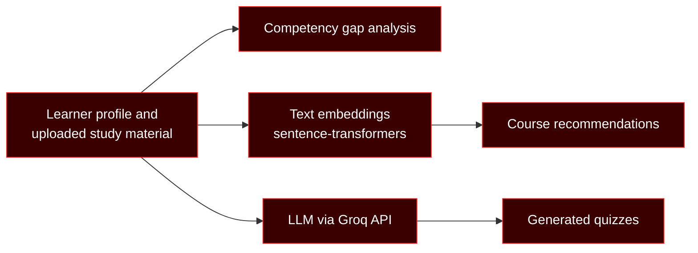
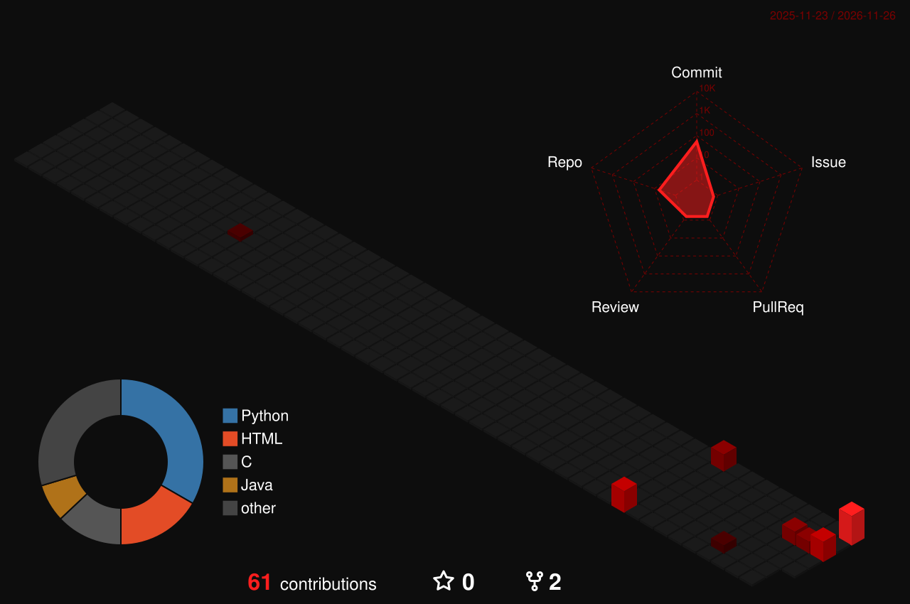

<div align="center">


[](https://github.com/mithulpranavv-dev)


[](https://www.linkedin.com/in/mithul-pranav-m-53979a37a/)
[](mailto:mithulpranavv@gmail.com)
[](https://github.com/mithulpranavv-dev)

</div>


```js
const mithul = {
  name: "Mithul Pranav M",
  institution: "SRM Institute of Science and Technology, Tiruchirappalli",
  degree: "B.Tech CSE (AI & ML), 2025 - 2029",

  currently: {
    exploring: ["LLM apps", "Embeddings", "Quantum computing (QAOA)"],
    lookingFor: "AI/ML internships, summer 2027",
  },

  philosophy: "Learn by building, then explain what I built.",
  openTo: ["Internships", "Collaborations", "Open Source"],
};
```

| | |
|---|---|
| 📍 **Based in** | Tiruchirappalli, Tamil Nadu, India |
| 🎓 **Studying** | B.Tech CSE (AI & ML), second year at SRMIST |
| 🛠️ **Main language** | Python |
| 🏆 **Hackathons** | Smart India Hackathon 2026 (internal round), Quantexa 24-Hour Hackathon |
| 🎪 **Organised** | YUVA 2026, a national-level tech fest |
| 💼 **Experience** | ML, AI and Data Science internship at CodeBind Technologies |


<div align="center">


</div>

| Area | Tools |
|---|---|
| **Languages** |    |
| **AI and ML** |     |
| **Quantum** |    |
| **Web** |    |


| Project | What it does | Tech |
|---|---|---|
| **AI Learning Platform for MoSPI** | Finds competency gaps, recommends courses with embeddings, and generates quizzes with an LLM. Smart India Hackathon 2026, internal round | React, FastAPI, Groq, sentence-transformers |
| **Quantum-Enhanced Traffic Optimization** | Treats signal timing across junctions as a QUBO, solved with QAOA, and compares it with classical baselines | Python, Qiskit, NetworkX, Streamlit |
| **Recruitment and Candidate Recommendation Platform** | Ranks candidates for a role using logistic classification. Built during my CodeBind internship | Python, machine learning |
| **AI-Integrated Staff Management Portal** | Team project of three, with a full project report | SRMIST team project |

**Quantum traffic optimiser**


**AI learning platform**





<div align="center">


</div>

<details>
<summary><b>Experience, workshops and leadership</b></summary>

- **Python, ML, AI and Data Science Intern**, CodeBind Technologies, Tiruchirappalli (Jun 2026)
- Vibe Coding (BrainBios) and Quantum Computing + ML (C-DAC) workshops, Gyanith 2026, NIT Puducherry
- Python inplant training, IoT workshop and placement aptitude test, CodeBind Technologies
- TCS iON Career Edge: Young Professional (Nov 2026)
- Organiser, YUVA 2026 national tech fest, SRMIST Tiruchirappalli
- Quantexa 24-Hour Hackathon (HackHere), Coimbatore, Sep 2026
- Smart India Hackathon 2026, internal round (Team TRIBYTES)

</details>


| When | What |
|---|---|
| Feb | Vibe Coding and Quantum Computing + ML workshops at NIT Puducherry |
| Jun | ML, AI and Data Science internship at CodeBind Technologies |
| Sep | Quantexa 24-Hour Hackathon and the quantum traffic project |
| Oct | Organiser, YUVA 2026 |
| Nov | TCS iON Career Edge: Young Professional |


- [x] Python for machine learning
- [x] Logistic regression and classification
- [x] QUBO and QAOA basics with Qiskit
- [ ] Building and evaluating LLM applications
- [ ] SQL and data engineering basics
- [ ] Land an AI/ML internship for summer 2027
- [ ] Publish my projects on GitHub, each with a clear README
- [ ] Contribute to an open source project


<div align="center">


</div>


Open to **AI/ML internships**, **collaborations** and **open source**. If you're hiring, building something or want to talk about AI or hackathons, message me.

<div align="center">

[](https://www.linkedin.com/in/mithul-pranav-m-53979a37a/)
[](mailto:mithulpranavv@gmail.com)


</div>
